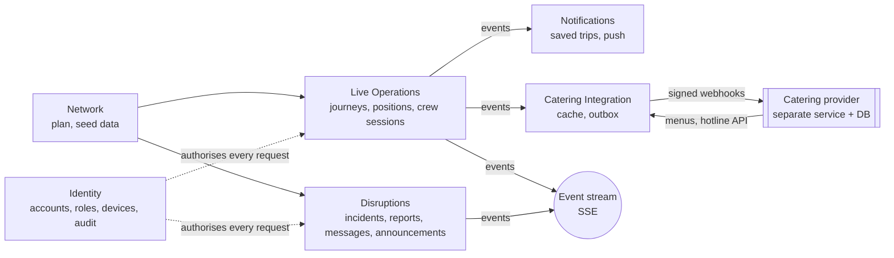
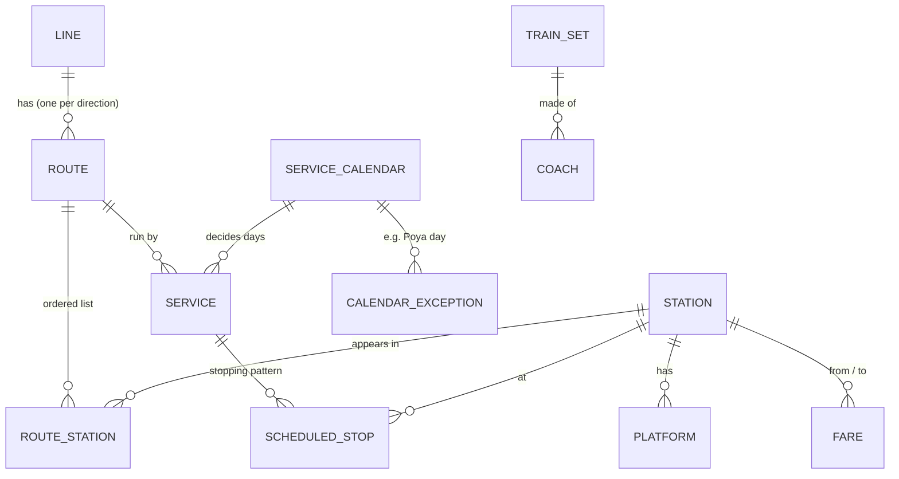
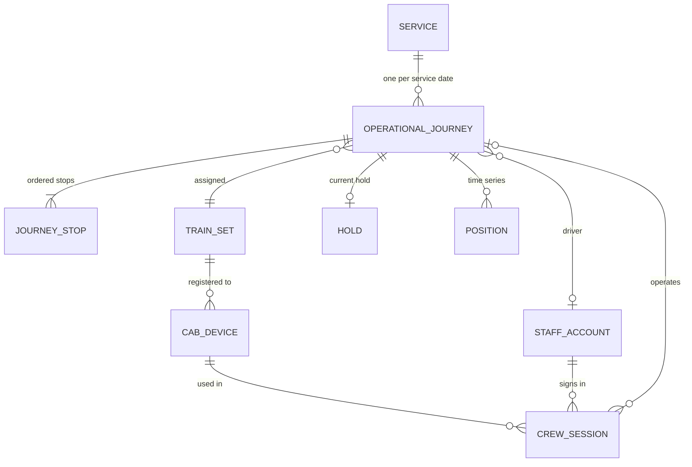
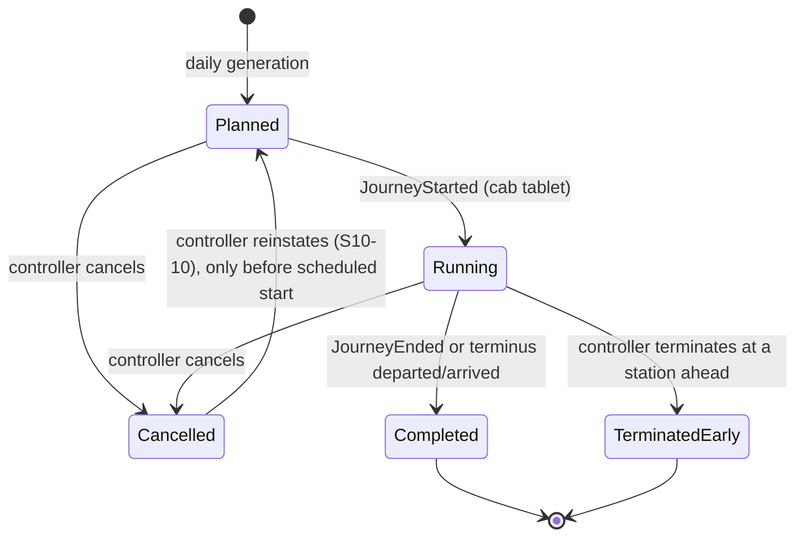
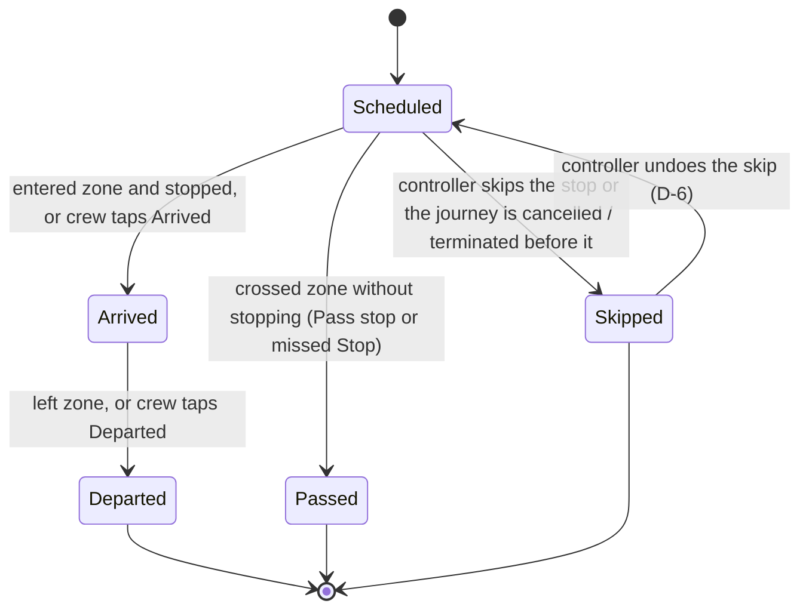
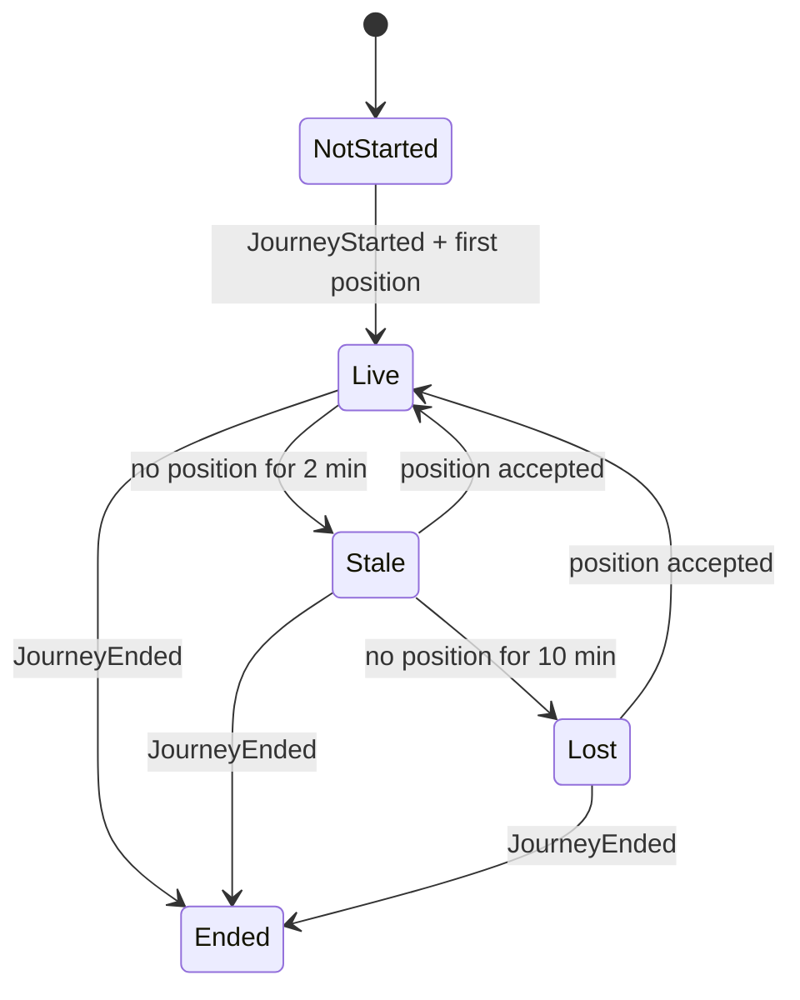

# SmartRail – Domain Model

**Phase:** Develop · **Status:** Agreed 8 Oct 2026 (D-1 to D-11); scope update 9 Oct (one line, one controller role) · **Owner:** Senuja
**Inputs:** Section 4 glossary and model sketch (`discover/00-brief-analysis.md`), `define/moscow.md`, `define/user-stories.md`, `define/edge-cases.md`, ADR-01 to ADR-07, event catalogue draft (Epic Breakdown page).
**Used by:** EF Core entities and migrations, OpenAPI contract, event schemas, the TDD test list (section 10), seed data (US-B1).

All decisions in section 11 were agreed on 8 Oct 2026.

---

## 1. Terms used in this document

| Term | Meaning here | SmartRail example |
|---|---|---|
| **Module** | A part of the backend that owns its data and rules. Other modules use it through its public interface or its events, never by writing its tables. | Live Operations |
| **Aggregate** | A group of objects changed together in one transaction, with one root that guards the rules. Outside code changes it only through the root. | Operational journey + its stops |
| **Entity** | An object with an identity that lasts while its values change. | A journey stop (Rambukkana on 1005, 7 Oct) |
| **Value object** | A value with no identity, compared by content, never changed in place. | `Delay(+7)`, `GeoPoint(7.32, 80.39)` |
| **Invariant** | A rule that must always be true after any change. | A departed stop cannot change platform |
| **Domain event** | A record that something has happened, named in the past tense. | `PlatformChanged` |

Why aggregates matter here: a controller action changes a journey and several of its stops at once and must be refused if someone else changed the journey first (A-66). One aggregate = one transaction = one version number.

---

## 2. Modules

The six modules from ADR-01, plus a small shared kernel.

| Module | Owns (aggregates / tables) | Reads from | Publishes |
|---|---|---|---|
| **Network** (plan) | Line, Station + Platforms, Route, Service + Scheduled stops, Service calendar, Train set + Coaches, Fare | – | – (read-only seed data in MVP) |
| **Live Operations** | Operational journey + Journey stops, Position (time series), Cab device, Crew session | Network | `JourneyStarted`, `JourneyEnded`, `TrainPositionUpdated`, `StopStatusChanged`, `DelayChanged`, `DataFreshnessChanged`, `JourneyHeld`, `PlatformChanged`, `JourneyCancelled`, `JourneyTerminatedEarly`, `StopSkipped`, `StopAdded`, `UnscheduledStopDetected` |
| **Disruptions** | Incident, Crew report, Crew message, Announcement | Network, Live Operations | `IncidentReported`, `IncidentCreated`, `CrewMessageSent`, `CrewMessageAcknowledged`, `AnnouncementPosted` |
| **Identity** | Passenger account, Staff account (role + scope), Display device, Provider client, Audit entry | – | – |
| **Notifications** | Saved trip, Push subscription, Notification sent | Live Operations events | – (sends push) |
| **Catering Integration** | Catering station cache, Outbox message, Provider health | Live Operations events | `ProviderHealthChanged`; integration events to the provider |
| *Shared kernel* | IDs, `ServiceDate`, `Source`, clock (`TimeProvider`), event envelope, audit writer | – | – |

**Placement decisions in this draft:**

- **Crew session and cab device are in Live Operations, not Identity.** They decide whether a position is accepted (R-07), which is an operations rule. Identity only issues the device credential.
- **Controller actions on a journey are in Live Operations.** Delay, hold, cancel, terminate, skip, add and platform change all change the journey aggregate. Disruptions owns the *incident* (the cause) and links effects to it.
- **Saved trips are in Notifications, not Identity.** Their only purpose in the MVP is deciding who gets a push.

---

## 3. Network module (the plan)

Read-only in the MVP: everything comes from seed data (US-B1). No scheduler screens (moved to Could in the MoSCoW list).

| Entity | Key fields | Notes |
|---|---|---|
| Line | id, name | **One line in the MVP (Main Line).** Kept as an entity so a second line is new data, not new code. |
| Station | id, code, name, location (`GeoPoint`), zoneRadiusM (default 300) | Real names and order, verified (S4-11). |
| Platform | stationId, number, inService | Number is text (some stations use "1A"). |
| Route | id, lineId, direction, name | One per direction. |
| RouteStation | routeId, sequence, stationId, distanceKm | Distance from the route start; used for position between stations (S5-08). |
| Service | id, number, routeId, trainType, calendarId | `trainType`: Express, Intercity, Slow (seed list). Number shown as secondary (P-2). |
| ScheduledStop | serviceId, sequence, stationId, arrivalOffset, departureOffset, plannedPlatform, callType | Offsets are **minutes from the start of the service date**, so overnight journeys stay on their service date (A-18). `callType`: Stop or Pass. |
| ServiceCalendar | id, daysOfWeek | + CalendarException (date, runs: yes/no), e.g. Poya day. |
| TrainSet | id, code, traction | `traction`: DieselPowerSet, DieselLocoHauled (no electric in seed data). |
| Coach | trainSetId, position, class, seating | `class`: First, Second, Third. `seating`: Reserved, Unreserved. |
| Fare | fromStationId, toStationId, class, priceLkr | Fixed per station pair and class (S4-10). Should (P-9). |

**Invariants (checked when seed data loads):**

- Scheduled stops follow the route's station order; each stop's station is on the route.
- departureOffset ≥ arrivalOffset; the first stop has no arrival, the last has no departure.
- The planned platform exists at that station. A Pass stop still has a time (used for "passed" detection).
- Fares exist in both directions for each pair (or one row marked symmetric).

---

## 4. Live Operations module (what is happening today)

### 4.1 Model

**Aggregate: Operational journey** (root) with its **Journey stops** (entities) and current **Hold** (value object).

| Field (journey) | Type | Notes |
|---|---|---|
| id | uuid | |
| serviceId, serviceDate | ref, date | Unique together. Created by daily generation, 3 days ahead (US-B2). |
| trainSetId, driverId | refs | From seed crew assignments. A journey has a driver only; the guard role is deferred (D-12). |
| status | `JourneyStatus` | State machine 4.2. |
| tracking | `TrackingStatus` | State machine 4.4. |
| currentDelay | `Delay` | Signed whole minutes; negative = early. |
| delaySource | `Source` | Who set the current delay. |
| hold | `Hold?` | stationId, reason, minutes? (planned duration), setBy, setAt. A flag, not a status (D-4); expected departure still follows the clock until released (R-22). |
| lastPosition | `GeoPoint` + time | Cached from the latest accepted position. |
| incidentId | ref? | The cause, if an incident is linked (Disruptions). |
| controlVersion | int | **Bumped only by decisions** (delay, hold, release, cancel, reinstate, terminate, skip / unskip / add stop, platform change, controller time correction). Sent back by clients as `expectedVersion` (R-18). |
| rowVersion | concurrency token | Internal EF Core token on every write; on a collision between automatic updates the server re-reads and retries. Never exposed in the API. |

| Field (journey stop) | Type | Notes |
|---|---|---|
| sequence, stationId | int, ref | Copied from the scheduled stop; added stops get a sequence between neighbours. |
| callType | Stop / Pass | |
| scheduledArrival, scheduledDeparture | timestamptz | Service date + offset, converted once at generation. |
| expectedArrival, expectedDeparture | timestamptz | Recalculated by R-02 / R-03. |
| actualArrival, actualDeparture | `TimeWithSource?` | Value + source + when it was recorded. |
| plannedPlatform, platform, previousPlatform | text | `previousPlatform` drives "Platform 3 (was 1)". |
| status | `StopStatus` | State machine 4.3. |
| isAdded | bool | Added by a controller (O-4). |

**Other entities in this module:**

| Entity | Key fields | Notes |
|---|---|---|
| Position | journeyId, deviceId, location, speedKmh, gpsTime, receivedAt, correctedTime | Append-only, partitioned by day, raw data kept 30 days (ADR-03). Not part of the aggregate; only the latest accepted position is cached on the journey. |
| CabDevice | **Owned by Identity since 14 Oct (D-13), not by this module.** Fields: id, code ("CAB-01"), trainSetCode (text), credentialHash, active | Registered in seed data (ADR-05). LiveOperations never reads Identity's table: the cab session token carries `deviceId` and the train set, and R-07 / S-11 use those. |
| CrewSession | **Owned by Identity since 15 Oct (D-14), there called `CabSession`:** id, accountId, deviceId, startedAt, endedAt?, clockOffsetMs. **Cab mode only**: a phone sign-in creates no session | One active session per driver **and per tablet**: a new sign-in ends the old one. The link to a journey (`journeyId`) will be kept by LiveOperations, keyed by the `crewSessionId` in the token. LiveOperations never reads Identity's table |

**Value objects:** `Delay` (signed minutes, with `IsLate`, `IsEarly`, `IsOnTime`), `GeoPoint`, `TimeWithSource`, `Hold`, `Source` (Controller = 1, Crew = 2, Gps = 3, Schedule = 4; lower number wins), `LeadTimeLevel` (Normal, ShortNotice, Late).

### 4.2 Journey status

- **Held is not a status.** A held train is still Planned or Running, so a hold is stored as a flag on the journey (D-4).
- **Running starts only from the cab tablet** (C-2). If the driver never presses Start, the journey stays Planned and tracking stays NotStarted. The ops dashboard shows it as "Not started" after its scheduled departure (edge case for forgotten Start).
- Cancellation, termination and holds are always declared by people, never inferred from GPS (S5-13).

### 4.3 Journey stop status

### 4.4 Tracking status (data freshness)

- **Stale:** apps show "Last seen at Rambukkana, 2 min ago"; the ETA is kept at the last delay.
- **Lost:** "Live location unavailable", and the apps fall back to scheduled times plus the last known delay.
- Crew taps still update stops while Stale or Lost (source priority R-05).

---

## 5. Business rules (the TDD core)

Each rule gets unit tests before its code (section 10). Time-dependent rules use `FakeTimeProvider`.

| ID | Rule | Source |
|---|---|---|
| **R-01** | **Delay** = actual time − scheduled time at the most recent stop event, in **whole minutes, rounded down** (59 s late = on time; 1 min 59 s late = 1 min late). Negative = early. Shown as "On time", "3 min late", "2 min early". | S5-09, S5-10, D-1 |
| **R-02** | **Expected arrival** at each remaining stop = scheduled arrival + current delay. Early running carries forward for arrivals. | S5-12 |
| **R-03** | **Expected departure** = max(scheduled departure, scheduled departure + current delay). A predicted departure is never earlier than scheduled; an actual early departure is recorded as it happened. | S5-11 |
| **R-04** | **Station zone detection** (radius 300 m): entered the zone and speed < 5 km/h for 20 s → Arrived; left the zone after Arrived → Departed; entered and left without meeting the stop condition → Passed. | S5-07, D-2 |
| **R-05** | **Source priority:** a stop time or the journey delay set by a higher-priority source (Controller > Crew > GPS > Schedule) cannot be overwritten by a lower one. A controller override stays until the controller clears it. | S5 source priority |
| **R-06** | **Freshness:** 2 min without an accepted position → Stale; 10 min → Lost; any accepted position → Live. | A-26 |
| **R-07** | **Position acceptance:** only from a registered cab device with an active cab session on a Running journey. Otherwise rejected (403). If the device's train set differs from the journey's, accept but warn (Should, S-11). | B-3, ADR-05 |
| **R-08** | **Position plausibility:** discard a position that is older than the last accepted one, more than 500 m from the route, or implies a speed above **120 km/h** since the last one (M-2, 12 Oct). Discarded positions are counted and logged, not stored as live. | S5 failure scenarios |
| **R-09** | **Clock correction:** event time = GPS time when present; otherwise device time + the clock offset measured at session start. | ADR-05 |
| **R-10** | **Unscheduled stop:** speed < 5 km/h for ≥ 3 min outside every station zone → one alert per stop, cleared when the train moves. | O-8 |
| **R-11** | **Platform change lead time** = **expected arrival** at the station − now (at the origin, where there is no arrival: expected departure − now) (M-1, 12 Oct): > 15 min Normal, 5–15 min ShortNotice, < 5 min Late. Late requires a hold. The "train will wait" message is sent only when the hold is actually set. | O-5, A-112–A-114 |
| **R-12** | **Platform conflict:** warn (do not block) if another journey is expected at the same station and platform within ±5 min of this train's expected arrival–departure window. | O-5, D-3 |
| **R-13** | **Platform change allowed** only for a stop that is Scheduled or Arrived, to a platform that exists and is in service at that station. | O-5 |
| **R-14** | **Cancel** only Planned or Running journeys; all remaining stops become Skipped. **Terminate early** only a Running journey, at a station ahead of the train; stops after it become Skipped. **Reinstate** only a Cancelled journey before its scheduled start. | O-4, S10-10 |
| **R-15** | **Skip a stop:** not the origin, not a stop already Departed or Passed. **Add a stop:** the station must be on the route between two remaining stops; its time is estimated from distance plus 1 min dwell, and the controller can edit it. | O-4, D-5 |
| **R-16** | **Push threshold:** notify a saved-trip holder when the delay at their stop changes by ≥ 5 min since the last notice, or on any platform change, cancellation, termination or stop change. Never send the same notice twice. | P-7 |
| **R-17** | **Scope:** the controller acts on every journey on the line; a station manager acts only on their own station (announcements, notices); crew act only on journeys assigned to them. *(Regional scope deferred with regions, 9 Oct.)* | O-1 |
| **R-18** | **Concurrency (control version):** every **decision** carries the `controlVersion` it was based on; if another decision happened since, it is refused with 409 and the latest state, so a person looks again. **Automatic updates** (GPS positions, detected arrive / pass / depart, crew Arrived / Departed taps, ETA recalculation) do **not** bump the control version; the server applies them to the latest state (source priority R-05) and retries internally on a database collision (`rowVersion`). Without this split, a moving train would invalidate the controller's version every few seconds. | A-66, agreed 12 Oct |
| **R-19** | **One active cab session per driver;** a new cab sign-in ends the previous session. The driver cannot start a journey from phone mode. | C-2, ADR-05 |
| **R-20** | **Out-of-order crew actions** from the offline queue are applied by their recorded (corrected) time, and never overwrite a newer value from the same or higher-priority source. | C-7 |
| **R-21** | **Time saved by a skipped stop:** when a stop is skipped, the delay for every later stop is reduced by that stop's **scheduled dwell** (scheduled departure − scheduled arrival), but **never below on time** (delay ≥ 0 after the reduction; an on-time or early train is unchanged). Braking and acceleration time is not estimated; GPS corrects it at the next stop. A controller-set delay still wins (R-05). | O-4, agreed 8 Oct (D-11) |
| **R-22** | **Time added by a hold:** while a journey is held at a station, its expected departure from that station = max(scheduled departure, now), so it moves forward with the clock, and later stops' expected times move with it (R-02). When the train departs, the delay is measured from the actual departure (R-01). Nobody enters the extra minutes by hand. | O-4, O-5, agreed 8 Oct (D-11) |

---

## 6. Disruptions module

| Entity | Key fields | States |
|---|---|---|
| **Incident** | id, type, description, location (station, or section between two stations), scope (Local / Network), startedAt, expectedClearAt, createdBy, fromReportId? | Open → Resolved |
| **Incident effect** | incidentId, journeyId, action (Delay, Hold, Cancel, Terminate, Skip, Add, PlatformChange), at | Links the cause to each journey action, for reasons in passenger messages and for audit. |
| **Crew report** | id, journeyId, type (fixed list), reportedBy, location (from the journey's last position), note?, reportedAt | New → ConvertedToIncident / Dismissed (with reason) |
| **Crew message** | id, journeyId, kind (Info / Instruction), text, sentBy, sentAt, deliveredAt?, acknowledgedAt? | Sent → Delivered → Acknowledged |
| **Announcement** | id, stationId, text (plain text only), priority (Emergency > Disruption > General), source (Manual / Automatic), validFrom, validTo, createdBy | Active → Expired / Withdrawn |

- A Network-scope incident drives the in-app banner (S-4, Should).
- Automatic announcements come from templates in the propagation rules (US-B6). The station manager can write manual ones only for their own station (R-17).

---

## 7. Identity, Notifications, Catering Integration

| Module | Entity | Key fields | Notes |
|---|---|---|---|
| Identity | PassengerAccount | id, name, email, phone, passwordHash, failedSignIns, lockedUntil?, createdAt, deletedAt? | Name used only for greeting, never sent to the provider (M-3, 12 Oct). Delete = anonymise (US-P5). |
| Identity | StaffAccount | id, staffNumber (unique, sign-in name), name, role, stationId?, passwordHash, isActive, failedSignIns, lockedUntil? · Should: pinHash (S-10) | Roles: Controller, StationManager, Driver (Guard deferred 14 Oct, D-12). Check constraint: StationManager ⇒ stationId set; other roles ⇒ stationId empty. The controller covers the whole line; drivers are limited by their journey assignments, not a place. Never deleted: leavers get `isActive = false` so the audit history keeps its reference. `name` is shown on screens but never put in events or logs (D-9). Provisioned by the organisation, never self-registered (D-10). *(9 Oct: regionId and chief / regional roles removed with the one-line scope.)* |
| Identity | DisplayDevice | id, stationId, kind (MainBoard / Platform / InfoScreen), platform?, credentialHash | Read-only credential (Q-2). |
| Identity | ProviderClient | id, name, signingSecretRef, apiKeyHash | Separate credential type (B-7). |
| Identity | AuditEntry | id, at, actorId, actorRole, action, targetType, targetId, reason?, summary, requestId | Append-only; the app's database user has insert-only rights (O-10). |
| Notifications | SavedTrip | id, passengerId, serviceId, fromStationId, toStationId | Today's status computed from the journey (US-P6). |
| Notifications | PushSubscription | passengerId, fcmToken, platform, updatedAt | |
| Notifications | NotificationSent | passengerId, journeyId, kind, valueKey, sentAt | Unique on (passenger, journey, kind, valueKey): this is the duplicate guard for R-16. |
| Catering | CateringStation | stationId, providerRef, hotline, openingHours, menuJson, fetchedAt | Cache refreshed every 5 min; "Menu unavailable" when the fetch fails (F-3). |
| Catering | OutboxMessage | id, eventId, type, payloadJson, createdAt, attempts, nextAttemptAt, deliveredAt?, lastError? | Written in the same transaction as the journey change (F-2). |
| Catering | ProviderHealth | status (Connected / Degraded / Unreachable), lastSuccessAt, pendingCount | Shown on the ops dashboard (F-4). |
| *Provider service (own DB)* | ReceivedEvent | eventId (unique), type, receivedAt, payloadJson | Unique `eventId` = de-duplication on the provider side. |

---

## 8. Event contracts

### 8.1 Envelope (every internal event)

| Field | Type | Purpose |
|---|---|---|
| eventId | uuid | Unique; consumers ignore duplicates. |
| sequence | long | Increasing per stream; used with `Last-Event-ID` to resume after reconnect (ADR-02). |
| type, version | string, int | e.g. `PlatformChanged`, 1. |
| occurredAt | timestamptz | When it happened (corrected time, R-09). |
| journeyId, serviceDate | uuid, date | Empty for station-only events (announcements). |
| stationIds | uuid[] | Lets the stream filter by station for displays. |
| lineId | uuid | Lets the stream filter by line (one line in the MVP; ready for more). |
| source | Source | Controller / Crew / Gps / Schedule. |
| causedBy | { actorId?, incidentId?, requestId } | Links to the audit entry and the incident. |

### 8.2 Payloads (version 1)

| Event | Payload |
|---|---|
| JourneyStarted | deviceId, crewSessionId |
| JourneyEnded | reason (Driver / Terminus / Controller) |
| TrainPositionUpdated | location, speedKmh, lastStationId, nextStationId, fractionToNext |
| StopStatusChanged | stationId, sequence, from, to, at |
| DelayChanged | delayMinutes, previousDelayMinutes, stops[] { stationId, expectedArrival, expectedDeparture } |
| DataFreshnessChanged | from, to, lastSeenAt, lastStationId |
| JourneyHeld | stationId, reason, released (bool) |
| PlatformChanged | stationId, platform, previousPlatform, leadTimeLevel, holdSet (bool) |
| JourneyCancelled | reason, incidentId? |
| JourneyTerminatedEarly | atStationId, reason |
| StopSkipped / StopAdded | stationId, sequence, expectedArrival? (added only) |
| UnscheduledStopDetected | location, stoppedSince, betweenStationIds[2] |
| IncidentReported | reportId, type, location, note? |
| IncidentCreated | incidentId, type, scope, description, affectedJourneyIds[] |
| CrewMessageSent / Acknowledged | messageId, kind, text (sent only) |
| AnnouncementPosted | announcementId, stationId, priority, text, validTo |
| ProviderHealthChanged | from, to, pendingCount |

- `StopStatusChanged` carries `source`, so a crew tap and a GPS detection are the same event type. The priority rule (R-05) lives only in the backend.
- **No personal data in any event.** Staff are referenced by ID; names are fetched by authorised apps only.

### 8.3 Integration events to the catering provider

`provider.eta-updated` and `provider.journey-changed`, sent only for journeys calling at catering stations.

- **Body:** eventId, type, occurredAt, serviceNumber, serviceDate, stationRef (the provider's own ID), scheduledArrival, expectedArrival, change (Cancelled / Terminated / StopSkipped / StopAdded), reason text.
- **Headers:** `X-SmartRail-Event-Id`, `X-SmartRail-Timestamp`, `X-SmartRail-Signature: sha256=<HMAC of timestamp + body>`.
- **The provider rejects** a bad signature (401) or a timestamp older than 5 minutes (replay protection), and treats a repeated `eventId` as already processed (200).
- **ETA updates are sent** only when the expected arrival changes by ≥ 1 min (ADR-07).

---

## 9. Data ownership and classification

| Class | Data | Owner | Who can read | Retention |
|---|---|---|---|---|
| Public | Network, timetable, live journey status, announcements, fares | Network / Live Operations | Anyone, no sign-in | – |
| Passenger personal | Account (email, phone), saved trips, push tokens | Identity / Notifications | The passenger; never staff screens, never the provider | Until account deletion |
| Staff operational | Crew sessions, crew reports, messages, staff accounts | Live Operations / Disruptions / Identity | Staff by role and scope | Rolling (to set with Section 20 work) |
| Train operational | Positions (train data from the cab tablet, not a person's location) | Live Operations | Controllers; derived status is public | Raw 30 days, then aggregated |
| Security | Audit log, credentials (hashed) | Identity | Controller (audit viewer) | Audit: kept; never edited |
| Provider-owned | Menus, availability, hotline, opening hours | Catering provider | Anyone, via SmartRail's cache | Cache only |

---

## 10. First TDD test list (for review before any code)

Written as test names. You approve, remove or add names; then the AI implements against them. Each maps to a rule.

**Delay and ETA (R-01 – R-03)**
- `Delay_is_zero_when_train_departs_59_seconds_late`
- `Delay_is_one_minute_when_train_departs_119_seconds_late`
- `Delay_is_negative_when_train_arrives_early`
- `Expected_arrival_adds_current_delay_to_scheduled_arrival`
- `Expected_departure_is_never_before_scheduled_departure_when_running_early`
- `Actual_early_departure_is_recorded_as_it_happened`

**Detection (R-04, R-10)**
- `Arrived_when_inside_zone_and_slow_for_20_seconds`
- `Passed_when_train_crosses_zone_without_stopping`
- `Departed_when_train_leaves_zone_after_arriving`
- `Unscheduled_stop_alert_after_3_minutes_stopped_outside_any_zone`
- `No_unscheduled_stop_alert_when_stopped_inside_a_station_zone`
- `Only_one_unscheduled_stop_alert_per_stop`

**Source priority, freshness, positions (R-05 – R-09, R-20)**
- `Gps_arrival_does_not_overwrite_crew_tapped_arrival`
- `Controller_delay_is_kept_until_controller_clears_it`
- `Tracking_becomes_stale_after_2_minutes_without_position`
- `Tracking_becomes_lost_after_10_minutes_without_position`
- `Tracking_returns_to_live_on_next_accepted_position`
- `Position_rejected_without_active_cab_session`
- `Position_rejected_from_unregistered_device`
- `Position_older_than_last_accepted_is_discarded`
- `Position_more_than_500m_from_route_is_discarded`
- `Position_implying_more_than_120_kmh_is_discarded`
- `Event_time_uses_gps_time_over_device_clock`
- `Queued_crew_tap_does_not_overwrite_newer_controller_value`

**Platform change (R-11 – R-13)**
- `Lead_time_is_measured_from_expected_arrival_except_at_origin`
- `Lead_time_over_15_minutes_is_normal`
- `Lead_time_between_5_and_15_minutes_is_short_notice`
- `Lead_time_under_5_minutes_requires_hold`
- `Train_will_wait_message_only_when_hold_is_set`
- `Conflict_warning_when_another_train_expected_at_same_platform_within_5_minutes`
- `Platform_change_refused_for_departed_stop`
- `Platform_change_refused_for_platform_not_at_station`

**Journey actions and concurrency (R-14, R-15, R-18, R-19, R-21, R-22)**
- `Skipping_a_stop_reduces_later_delay_by_its_scheduled_dwell`
- `Skipping_a_stop_never_makes_an_on_time_train_early`
- `Held_train_expected_departure_moves_forward_with_the_clock`
- `Cancel_marks_all_remaining_stops_skipped`
- `Terminate_refused_for_station_already_passed`
- `Reinstate_refused_after_scheduled_start`
- `Skip_refused_for_origin_station`
- `Action_refused_when_journey_version_is_stale`
- `Gps_update_does_not_invalidate_controller_version`
- `Crew_tap_does_not_invalidate_controller_version`
- `New_cab_sign_in_ends_previous_cab_session`
- `Start_journey_refused_in_phone_mode`

**Scope and notifications (R-16, R-17)**
- `Driver_cannot_act_on_journey_not_assigned_to_them`
- `Station_manager_cannot_post_announcement_for_another_station`
- `Push_sent_when_delay_changes_by_5_minutes`
- `Push_not_sent_twice_for_the_same_change`

---

## 11. Decisions (all agreed 8 Oct)

| # | Question | Proposal | Why |
|---|---|---|---|
| D-1 ✔ | How is delay rounded? | Round **down** to whole minutes | Never shows a train as later than it is; 59 s late reads as "On time". Alternative: round to nearest. |
| D-2 ✔ | What counts as "stopped" in a station zone? | Speed < 5 km/h for 20 s | Avoids slow-running trains counting as arrived. Tune with simulator data. |
| D-3 ✔ | Platform conflict window | ±5 min around the expected arrival–departure window, warning only | The controller may know the other train is leaving; blocking would be wrong. |
| D-4 ✔ | Is "Held" a journey status? | **No:** a flag on a Planned or Running journey | A held train is still running; a status would hide that it is also late or on time. |
| D-5 ✔ | Time for an added stop | Estimated from distance + 1 min dwell, editable by the controller | The controller often knows better; the estimate avoids an empty field. |
| D-6 ✔ | Can a skipped stop be restored? | Yes, while the train has not passed it | Mistakes happen (mirrors reinstating a cancellation, S10-10). |
| D-7 ✔ | Which region owns a journey crossing two regions? | **Superseded 9 Oct:** one line and one controller role in the MVP, so no regions. Proposal kept for later: region of the **next stop** | Control would hand over naturally as the train moves |
| D-8 ✔ | Entity name for the live stop | `JourneyStop`, with a `status` field; the glossary term "journey stop status" describes its live state | Shorter in code. Glossary updated: entity `JourneyStop`; "journey stop status" = its `status` field. |
| D-9 ✔ | Staff account fields and scope | **Agreed 8 Oct:** fields as in section 7; one role per person; scope in an optional `stationId` column guarded by a check constraint per role (regionId removed 9 Oct) | Simplest option that the database can enforce. A `RoleAssignment` table (several roles, history) is deferred until a user management screen exists (Could). |
| D-10 ✔ | Who creates staff accounts? | **Agreed 8 Oct:** the organisation, never the staff member. MVP: seed data (O-1). Later: a system administrator or an HR directory feed (single sign-on) handles joiners, movers and leavers; staff can only set and change their own password or PIN | A staff account grants operational power; identity, role and scope must come from the organisation. Seed passwords are demo values kept in development configuration only. |
| D-11 ✔ | Should skipping a stop reduce later times, and how does a hold add time? | **Agreed 8 Oct:** skip → subtract the stop's scheduled dwell from the delay, never below on time (R-21); hold → expected departure follows the clock until the train leaves (R-22) | Raised by me: the model ignored time saved by skips. Mirrors added stops (D-5), which add time. Conservative: only known timetable dwell is subtracted, never a guessed braking time, and no early prediction from a skip. |
| D-12 ✔ | Is the guard a role in the MVP? | **Agreed 14 Oct (Senuja):** no. Roles are Controller, StationManager, Driver; a journey references a driver only; `CrewPhone` = Driver | The brief only requires the driver; no E2E flow needs the guard; one role fewer in sign-in, seed data and the permission matrix. The guard stays a discovered actor for later (`moscow.md` change log). |
| D-13 ✔ | Which module owns `CabDevice`? | **Agreed 14 Oct (Senuja), spec change:** Identity (id, code, trainSetCode as text, credentialHash, active). The cab session token carries the device and its train set to LiveOperations. A deactivated device is refused at its next sign-in or refresh (within one access-token life, 15 min) | The device credential is authentication, which Identity owns; LiveOperations needs only the answer, not the table. Section 4.1 and the architecture rule "never read another module's tables" stay intact. |
| D-14 ✔ | Which module owns the crew session, and is there one for phones? | **Agreed 15 Oct (Senuja), spec change:** Identity owns it, as `CabSession`, for **cab mode only**; phones get no session. One active session per driver and per tablet (database-enforced). The session is checked on **every request** that carries `crewSessionId`. The session ends by sign-out (the app signs out after End journey, for now), a newer sign-in, a deactivated device at its next refresh, or the 12-hour limit. Later: a `JourneyEnded` event through the outbox ends it | Token validity depends on the session, so the session belongs where the token is made and checked; LiveOperations cannot call Identity and needs only the ids in the token |

---

## 12. Changes from the Section 4 sketch

| Change | Reason |
|---|---|
| `Driver` became `StaffAccount` with a role (Controller, StationManager, Driver) and the journey references a driver. *(A guard was planned until 14 Oct, D-12.)* | Roles drive authorisation. |
| `StaffAccount` gained credentials, `isActive`, lockout fields and a role-to-scope check constraint. | D-9, D-10; Q-2 lockout. |
| Added `CabDevice` and `CrewSession`. Both are owned by Identity (D-13, D-14); `CrewSession` is called `CabSession` there. | ADR-05 (cab tablet, one active session). |
| Added `Hold` as a value object on the journey, not a status. | D-4. |
| Added `TrackingStatus` separate from `JourneyStatus`. | A journey can be Running with Lost data; mixing them hides one of the two. |
| Added `Position` as a time-series table outside the aggregate. | Volume (every 10 s); the aggregate keeps only the latest. |
| `PassengerTrip` removed from the backend model. | "I'm on this train" is a device-side mode (P-3); no passenger location is stored (A-10). |
| Added Incident effects, Crew report, Crew message, Announcement, Audit entry, Outbox message. | Sections 9, 10, 11 and O-10. |

## AI usage log

| Activity | AI contribution | Validation / my decision |
|---|---|---|
| Domain model draft | Proposed modules, aggregates, state machines, rules R-01–R-20, event payloads and the test list from the agreed requirements | Reviewed: D-1–D-8 accepted as proposed on 8 Oct; test list approved before implementation (ADR-08 hybrid approach) |
| Staff account (8 Oct) | Asked by me whether every staff field was needed. AI explained each field, flagged that two optional scope columns allow invalid rows, offered three fixes, and listed missing credential fields | **My decision:** keep the fields, add credentials / `isActive` / lockout, enforce scope with a check constraint (D-9) |
| Staff provisioning (8 Oct) | My question: admin or self-registration? AI explained organisation-provisioned accounts and the joiner / mover / leaver process | **Agreed:** organisation provisions; seed data in MVP; self-service limited to own password / PIN (D-10) |
| Skipped stops and holds (8 Oct) | **My finding:** removing stops should reduce journey time. AI confirmed the gap in R-02, split saved time into known dwell vs guessed braking time, and linked it to holds adding time | **Agreed:** R-21 (subtract dwell, never below on time), R-22 (hold follows the clock); 3 new tests |
| One line, one controller (9 Oct) | AI listed the consequences of my scope cut before any change (removed: regions, interchanges, regional scope, P-12; kept: concurrency checks, conflict warning, `Line` entity) | **My decision:** one Main Line, one controller role; extend next release |
| Contract decisions (12 Oct) | Writing the API contract surfaced 4 mismatches between stories and this model (M-1–M-4) | **Accepted:** lead time from expected arrival, 120 km/h limit, passenger name, hold duration; 2 new tests |
| Journey version (12 Oct) | My question "what is journey version"; AI explained optimistic concurrency and found a flaw in its own R-18: GPS updates would invalidate the controller's version every few seconds | **Agreed:** control version bumped only by decisions; internal row version for automatic updates |
