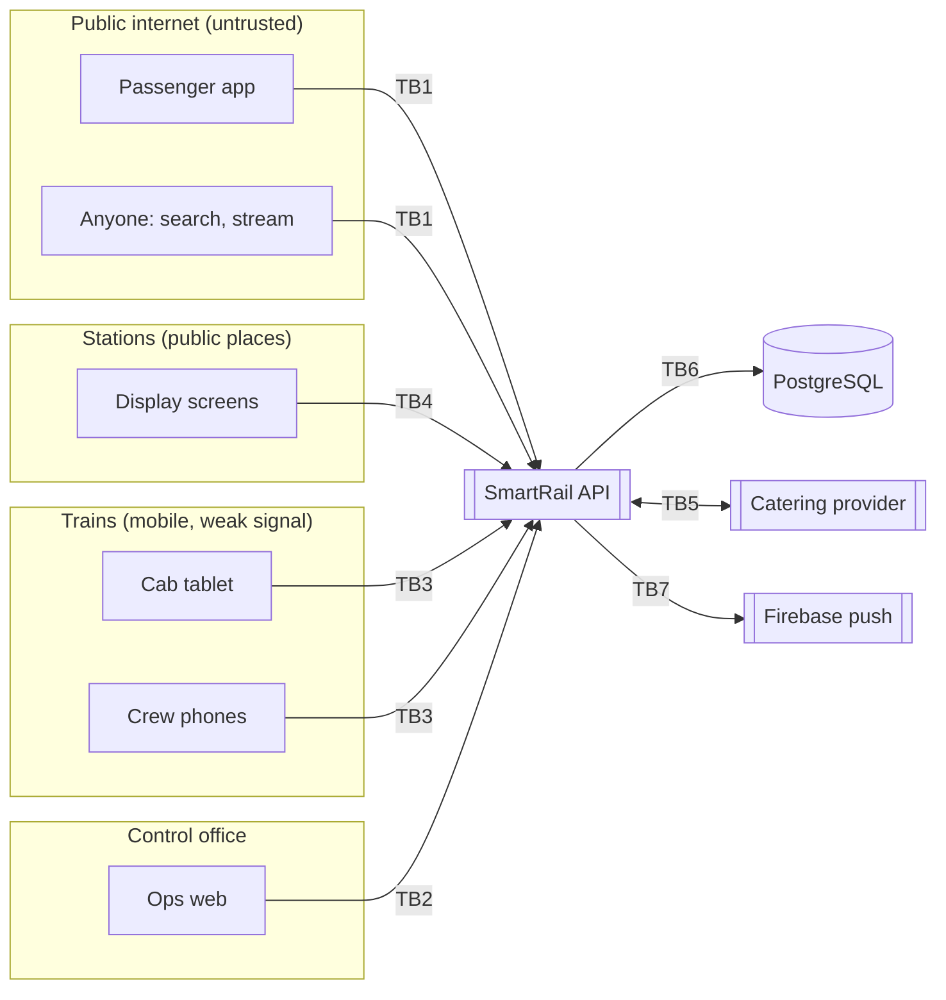

# SmartRail – Threat Model v1

**Phase:** Develop · **Version:** v1 draft, 9 Oct 2026 (completed with evidence on 16–17 Oct) · **Owner:** Senuja
**Method:** STRIDE per trust boundary. **S**poofing (pretending to be someone), **T**ampering (changing data), **R**epudiation (denying an action), **I**nformation disclosure (leaking data), **D**enial of service (making it unavailable), **E**levation of privilege (doing more than allowed).
**Inputs:** `02-api-contract.md` (credentials, policies), `01-domain-model.md` (data classes, rules), `03-architecture-principles.md`, brief §17 and §20.

---

## 1. What we protect

| Asset | Why it matters | Data class |
|---|---|---|
| **Operational control** (cancel, platform change, hold) | A false action misleads thousands and can put people on the wrong platform | Operational |
| Live journey data (positions, delays) | Wrong data breaks trust; passengers miss trains | Public (derived) / train operational |
| Passenger accounts (name, email, phone, password hash) | Personal data (§20) | Passenger personal |
| Staff credentials and sessions | Gateway to operational control | Security |
| Device credentials (cab tablets, displays) | Gateway to position intake / public screens | Security |
| Audit log | Evidence after an incident; must be trustworthy | Security |
| Provider webhook secret and API keys | Gateway to the integration | Security |
| Public screens (displays) | Visible to everyone in a station; defacement or false messages cause panic | Public |

---

## 2. Trust boundaries

| ID | Boundary | Who is on the untrusted side |
|---|---|---|
| TB1 | Internet → API | Anyone, including attackers and bots |
| TB2 | Ops web → API | Staff browsers (phishing, stolen sessions) |
| TB3 | Crew devices → API | Tablets and phones that can be lost or stolen, in areas with no signal |
| TB4 | Display devices → API | Screens physically reachable by the public |
| TB5 | SmartRail ↔ provider | Another organisation's system |
| TB6 | API → database | Only the API (but a bug or injection could abuse it) |
| TB7 | API → Firebase | Third-party service delivering pushes |

---

## 3. Threats and controls

Likelihood (L) and impact (I): H / M / L. **Day** = build day the control is implemented (delivery plan).

| ID | Boundary | STRIDE | Threat | L / I | Controls | Day | Evidence (17 Oct) |
|---|---|---|---|---|---|---|---|
| T-01 | TB2 | S | Stolen or guessed **staff password** used to cancel trains | M / H | Lockout after 5 failures (15 min); rate limit on sign-in; 30-min idle expiry; every action audited with actor; staff 2FA is Should (S-8) | 10 | Brute-force test hits lock; audit shows actor |
| T-02 | TB3 | S | **Fake positions** sent by someone who is not the cab tablet → train shown in the wrong place | M / H | Positions only from a registered device credential + active cab session on a running, assigned journey (R-07); plausibility checks: older than last, > 500 m off route, too fast (R-08) | 11 | Tests: unregistered device 401, phone token 403, jump discarded |
| T-03 | TB5 | T / S | **Forged or replayed webhook** to the provider ("1005 cancelled") | M / M | HMAC signature over timestamp + body; reject timestamps > 5 min old; unique `eventId` de-duplication (domain model 8.3) | 15 | Tampered body → 401; replay → rejected; duplicate → 200, no second effect |
| T-04 | TB1–TB4 | E | **Doing more than allowed:** station manager acts on another station; crew act on a journey not assigned to them; passenger calls ops endpoints; display token writes; a phone starts a journey | M / H | Policy per endpoint + scope check in the handler (R-17); separate credential types (B-7); cab-only endpoints (R-19) | 10 | **Permission matrix test**: every endpoint × every role, expected allow / deny |
| T-05 | TB1 | I / T | **IDOR** (insecure direct object reference): passenger reads or deletes another passenger's saved trips by guessing an ID | M / M | `/me/…` endpoints take no passenger ID; ownership checked from the token; UUIDs | 13 | Test: passenger B cannot read / delete A's trip |
| T-06 | all | I | **Personal data leaks** into logs, events, URLs or the provider | M / H | Structured logging with an allow-list of fields; no personal data in events (staff by ID only); no PII in query strings; no passenger data to the provider | 10, 16 | Log scan test for emails / phones; event schema review |
| T-07 | TB1 | I | **Public stream leaks staff data** (sources, staff IDs, crew reports, alerts) | M / M | Separate streams (public / ops / crew); public projection strips staff fields (contract §4) | 11 | Test: public stream never contains `IncidentReported`, `source`, staff IDs |
| T-08 | TB2 → TB4 | T | **Script or markup injected through an announcement** shown on public displays (defacement, false emergency) | L / H | Announcements plain text only, max 200 chars, rendered as text (React escapes); Content-Security-Policy on display app; only station managers for their own station; audited with author | 12, 15 | Test: `<script>` and HTML appear as literal text |
| T-09 | TB6 | T / I | **SQL injection** | L / H | EF Core parameterised queries; no string-built SQL; input validation | 10 | Code review + tests with injection strings |
| T-10 | TB1 | D | **Flooding:** sign-in brute force, search spam, thousands of SSE connections | M / M | Rate limits per IP and per credential (429); max SSE connections per IP; heartbeat timeouts drop dead connections. **Status: planned 17 Oct.** Sign-in is already protected by the account lockout (5 failures → 15 min, T-01); the per-IP limit is not built yet | 16 | Load test of rate limits; connection limit test |
| T-11 | TB2 | R | Controller **denies** making a cancellation | L / M | Append-only audit log; app database user has insert-only rights on it; request IDs link logs and audit | 10 | Attempted update / delete on audit table fails |
| T-12 | TB3 | S / I | **Stolen cab tablet** | M / M | Kiosk mode; staff sign-in still required; device credential can be deactivated (**takes effect at the device's next sign-in or refresh, so within one access-token life of 15 min**, D-13); session ends on End journey; MDM remote wipe in production | 14 | Deactivated device → 401 at the next sign-in / refresh |
| T-13 | TB4 | S / I | **Stolen display credential** (screen is in a public place) | M / L | Read-only token, own station only; refused by every write endpoint; revocable | 15 | Display token on write endpoints → 403 (permission matrix) |
| T-14 | TB2 | S | **Session theft in the browser** (cross-site scripting stealing tokens) | L / H | Access token in memory only; refresh token in `HttpOnly; Secure; SameSite=Strict` cookie, rotated, reuse revokes the session (C-3); CSP | 12 | Refresh reuse test; cookie flags checked |
| T-15 | build | I | **Secrets committed** to the repo (seed passwords, HMAC secret, API keys) | M / M | .NET user-secrets / environment variables; demo values only in development config; secret scanning in CI | 9 | CI scan report |
| T-16 | build | T | **Supply chain:** vulnerable package, or an AI-suggested package that doesn't exist or is a look-alike ("slopsquatting") | M / H | Every new dependency checked by me (exists, maintained, official); lock files committed; dependency scanning in CI (`dotnet list package --vulnerable`, `npm audit`, Dependabot) | 9 | CI report; dependency review notes in AI log |
| T-17 | TB3 | T | **Wrong tablet clock** makes a train look early or late | M / M | GPS time first, else clock offset measured at sign-in (R-09) | 11 | Test with a skewed device clock |
| T-18 | TB3 | T | **Replayed or duplicated crew action** from the offline queue | M / L | `clientActionId` idempotency; older actions never overwrite newer or higher-priority values (R-20) | 14 | Resend test: no duplicate arrival |
| T-19 | TB3 | T | **Over-posting:** a crew request sets `"source": "Controller"` to win priority | L / H | Source always set by the server from the token, never read from the body; request models contain only allowed fields | 11 | Test: body field ignored |
| T-20 | TB5 | D | **Provider slow or down** blocks SmartRail | M / M | Outbox delivery is asynchronous; menu fetch has timeouts and a cache; train information never depends on the provider | 15 | Stop provider during E2E flow 5: controller action still succeeds |

---

## 4. Security decisions

| Decision | Reason |
|---|---|
| **No full OAuth 2.0 / OpenID Connect in the MVP:** ASP.NET Core Identity (password hashing, lockout) + backend-issued JWT access tokens and rotating refresh tokens | All four apps are first-party and call only SmartRail's API, so there is no third party to delegate access to; tokens follow OAuth practices (short-lived bearer tokens, rotation, claims), so moving to OIDC (staff single sign-on with the railway directory) or OAuth client credentials (partner APIs) later replaces the token issuer, not the apps or rules (decided 12 Oct) |
| Separate credential types for passengers, staff, crew devices, displays and the provider | One stolen credential type cannot be used against another boundary (T-04, T-13) |
| Scope checked in handlers, not only by role | Role alone would let any station manager post to every station, or any driver act on any train (T-04) |
| Source of every value set by the server | Priority rules (R-05) are a security control as well as a business rule (T-19) |
| Display app built separately from ops web | Public devices never download operational code or routes (ADR-06) |
| Audit log append-only at database level | Integrity does not depend on application code being bug-free (T-11) |
| No passenger data to the provider in this release | Removes a whole class of disclosure risk (T-06) |

---

## 5. Accepted risks (MVP)

| Risk | Why accepted | Future control |
|---|---|---|
| No staff two-factor sign-in (S-8 is Should) | Time; seed accounts only | 2FA or directory single sign-on (D-10) |
| No mobile device management for cab tablets | Hardware / vendor scope | MDM: kiosk lock, remote wipe |
| Single backend instance | Scalability is the lowest quality goal | Load balancer + shared event bus |
| Demo secrets in development configuration | Local demo only | Secret store (e.g. Azure Key Vault) |
| No external penetration test | Assessment scope | Before any real deployment |
| `429 SIGN_IN_LOCKED` reveals that a locked staff number exists (an attacker who triggers the lock learns the number is real). The contract requires the lock message (§6), and staff numbers are not secret | Users must be told why they cannot sign in; staff accounts are seeded, not self-registered; the lock lasts 15 min and adds no new access | Generic 401 plus an email / SMS notice to the account holder when staff have contact details |

---

## 6. Security testing plan (17 Oct)

1. **Permission matrix:** every endpoint × every role and credential type, expected allow / deny, automated (T-04, T-13).
2. **Authentication:** lockout, generic errors, token expiry, refresh reuse (T-01, T-14).
3. **Integration:** tampered signature, old timestamp, duplicate event (T-03).
4. **Input:** injection strings in announcements, notes and search; oversize payloads (T-08, T-09).
5. **Data exposure:** public stream content, log scan for personal data (T-06, T-07).
6. **Abuse:** rate limits and connection limits (T-10).
7. **Pipeline:** secret scan and dependency scan reports (T-15, T-16).
8. **AI review:** an independent agent reviews auth and webhook code against this threat model; findings triaged in the defect log.
